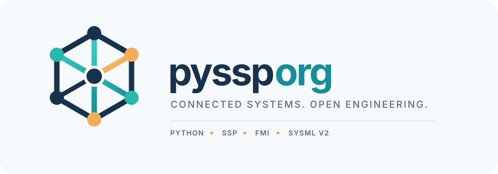
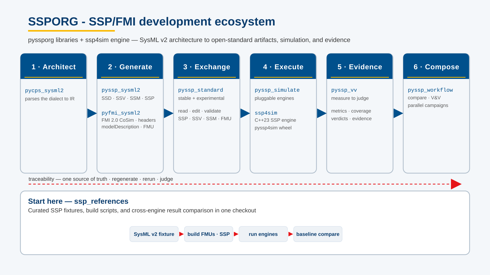

Tooling for modeling and simulation using [SSP (System Structure and Parameterization)](https://ssp-standard.org), [FMI](https://fmi-standard.org), and [SysML v2](https://www.omg.org/spec/SysML/).

Our libraries let you create, inspect, and edit simulation packages; simulate them across interchangeable engines and compare the results; bridge SysML v2 architectures to SSP/FMI artifacts; turn CSV signals into FMUs; wrap Model Exchange FMUs into Co-Simulation FMUs; and run verification-and-validation workflows over the whole chain. Most repos are MIT-licensed Python; several embed C/C++ runtimes or engines.

## Repositories

### Core & foundation

| Repository | Language | Maturity | Description |
| --- | --- | --- | --- |
| [pyssp_standard](https://github.com/pyssporg/pyssp_standard) | Python | stable | Core library to interact with files specified by the SSP standard. Create, read, and edit SSV, SSM, and SSB files; read SSP, FMU, and SSD files. Also supports the SRMD standard. |
| [ssp_references](https://github.com/pyssporg/ssp_references) | Python | beta | Curated SSP model fixtures plus the scripts used to prepare them, simulate them, and compare results across engines. |

### Simulation

| Repository | Language | Maturity | Description |
| --- | --- | --- | --- |
| [pyssp_simulate](https://github.com/pyssporg/pyssp_simulate) | Python | beta | Simulate SSP packages through a single interface with pluggable engines — FMPy (default), OMSimulator, ssp4sim, and cosim — and compare results across engines. |
| [ssp4sim](https://github.com/pyssporg/ssp4sim) | C++ | beta | FMI and SSP simulation engine. |
| [ssp4cpp](https://github.com/pyssporg/ssp4cpp) | C++ | beta | C++23 library for reading and analyzing SSP archives: loads `.ssp` files, parses the system structure (`ssd`), and parses FMI 2.0 FMUs and their model descriptions. |

### SysML v2 bridging

| Repository | Language | Maturity | Description |
| --- | --- | --- | --- |
| [pyssp_sysml2](https://github.com/pyssporg/pyssp_sysml2) | Python | beta | Generate SSP, FMI, and SysML artifacts from a SysML v2 architecture or SSD, and sync SSD wiring changes back into SysML. |
| [pycps_sysml2](https://github.com/pyssporg/pycps_sysml2) | Python | beta | The SysML dialect layer for CPS artifacts: parses SysML v2 into a repo-owned IR and owns variation, selection, constraints, and every marker and metadata accessor for the SSP and FMI dialects. |
| [pyfmi_sysml2](https://github.com/pyssporg/pyfmi_sysml2) | Python | beta | Generate FMI 2.0 Co-Simulation artifacts from a SysML v2 architecture: `modelDescription.xml`, C interface headers, Modelica connectors, and a packaged `.fmu`. |

### verification & validation

| Repository | Language | Maturity | Description |
| --- | --- | --- | --- |
| [pyssp_vv](https://github.com/pyssporg/pyssp_vv) | Python | alpha | Verification and validation for simulation models: measurement (series, alignment, metrics, coverage, normalisation) and judgment (criteria, dispositions, verdicts), linked by policy and evidenced by reports. |
| [pyssp_workflow](https://github.com/pyssporg/pyssp_workflow) | Python | alpha | Composable workflows for building, running, comparing, verifying, and validating SSP models — as plain functions and as node-ready work units. Composes `pyssp_standard`, `pyssp_simulate`, `pyssp_vv`, and `pyssp_sysml2`; owns none of them. |
| [pylsuq](https://github.com/pyssporg/pylsuq) | Python | alpha | Python implementation of the LS-UQ (Uncertainty Quantification) standard developed as part of the OpenSCALING project. Loads and saves LS-UQ XML documents via a dataclass-based XML-to-Python mapping. |

### FMU & packaging

| Repository | Language | Maturity | Description |
| --- | --- | --- | --- |
| [pyfmu_csv](https://github.com/pyssporg/pyfmu_csv) | Python + C++ | alpha | Generate FMI 2.0 Co-Simulation FMU packages from CSV-described signals, with a C++ runtime embedded in the FMU. |
| [pyfmi_me_to_cs](https://github.com/pyssporg/pyfmi_me_to_cs) | Python + C | alpha | Convert a complete SSP package (`.ssp`) — one or more FMI 2.0 Model Exchange FMUs wired together in a `SystemStructure.ssd` — into a single FMI 2.0 Co-Simulation FMU (`.fmu`), with a C wrapper and a local solver. |

### Execution infrastructure

| Repository | Language | Maturity | Description |
| --- | --- | --- | --- |
| [sequence_extensions](https://github.com/pyssporg/sequence_extensions) | Python | stable | Higher-order function extensions for Python lists, dicts, and generators, plus a mini flow engine on dependency-graph futures: deterministic parallel campaigns, local or at HPC, with retries, timeouts, and a JSON-lines run log. |

### Experimental

| Repository | Language | Maturity | Description |
| --- | --- | --- | --- |
| [experimental_pyssp_standard](https://github.com/pyssporg/experimental_pyssp_standard) | Python | experimental | Experimental fork of `pyssp_standard` with refactored SSP/FMI model APIs for the pyssp ecosystem. Under active development; not a release line. |
| [pyfmi_distributed](https://github.com/pyssporg/pyfmi_distributed) | Python + C++ | experimental | Turn a SysML v2 definition of an FMU into an optimized C++17 realtime runtime, packaged as an FMI 2.0 Co-Simulation FMU, with transport adapters for HLA, DIS, DCP, ROS 2, and ED-247. |

Maturity: `stable` — production-ready; `beta` — usable, API still evolving; `alpha` — early, breaking changes expected; `experimental` — very early, so many changes...

## Where to Start

- **Working with SSP files in Python** — start with [`pyssp_standard`](https://github.com/pyssporg/pyssp_standard), the foundation the other tools build on.
- **Simulating an SSP package** — install [`pyssp_simulate`](https://github.com/pyssporg/pyssp_simulate); the default FMPy backend works out of the box, and additional engines are opt-in extras.
- **Looking for example models** — see the reference fixtures in [`ssp_references`](https://github.com/pyssporg/ssp_references).
- **Verifying and validating a model** — measure and judge simulation results with [`pyssp_vv`](https://github.com/pyssporg/pyssp_vv), or compose a full build–run–compare–validate chain with [`pyssp_workflow`](https://github.com/pyssporg/pyssp_workflow).
- **Coming from a SysML v2 architecture** — use [`pyssp_sysml2`](https://github.com/pyssporg/pyssp_sysml2) to generate SSD, SSV, and FMI artifacts; [`pycps_sysml2`](https://github.com/pyssporg/pycps_sysml2) is the shared SysML dialect layer, and [`pyfmi_sysml2`](https://github.com/pyssporg/pyfmi_sysml2) targets FMI artifacts directly.
- **Realtime and distributed simulation** — turn a SysML v2 FMU definition into a realtime runtime with [`pyfmi_distributed`](https://github.com/pyssporg/pyfmi_distributed).
- **Packaging models as FMUs** — turn CSV data into an FMU with [`pyfmu_csv`](https://github.com/pyssporg/pyfmu_csv), or wrap Model Exchange FMUs into a single Co-Simulation FMU with [`pyfmi_me_to_cs`](https://github.com/pyssporg/pyfmi_me_to_cs).
- **Uncertainty quantification** — work with LS-UQ documents via [`pylsuq`](https://github.com/pyssporg/pylsuq).
- **Running parallel campaigns** — [`sequence_extensions`](https://github.com/pyssporg/sequence_extensions) provides the flow engine for deterministic parallel runs, local or at HPC.

## Ecosystem

The tools interoperate with engines and standards from the wider co-simulation community: [FMPy](https://pypi.org/project/FMPy/), [OMSimulator](https://pypi.org/project/OMSimulator/) (OpenModelica), [cosim](https://github.com/open-simulation-platform/cosim-cli) (Open Simulation Platform), and the [FMI](https://fmi-standard.org) and [SSP](https://ssp-standard.org) standards.

## Publications

Relevant publications on standardization of artifacts in the modeling workflow — references only, see [pyssp_publications](https://github.com/pyssporg/pyssp_publications) for BibTeX.

- M. Eek, R. Hällqvist, H. Gavel, and J. Ölvander, "A Concept for Credibility Assessment of Aircraft System Simulators," *AIAA Journal of Aerospace Information Systems*, vol. 13, no. 6, 2016, pp. 219–233. doi:[10.2514/1.I010391](https://doi.org/10.2514/1.I010391)
- R. Hällqvist, J. Schminder, M. Eek, R. Braun, R. Gårdhagen, and P. Krus, "A Novel FMI and TLM-based Desktop Simulator for Detailed Studies of Thermal Pilot Comfort," *Proc. 31st Congress of the International Council of the Aeronautical Sciences*, ICAS20180203, 2018.
- J. Schminder, R. Hällqvist, M. Eek, and R. Gårdhagen, "Pilot Performance and Heat Stress Assessment Support Using a Cockpit Thermoregulatory Simulation Model," *Proc. 31st Congress of the International Council of the Aeronautical Sciences*, ICAS20180463, 2018.
- L. Ochel, R. Braun, B. Thiele, A. Asghar, L. Buffoni, M. Eek, P. Fritzson, D. Fritzson, S. Horkeby, R. Hällqvist, Å. Kinnander, A. Palanisamy, A. Pop, and M. Sjölund, "OMSimulator - Integrated FMI and TLM-based Co-simulation with Composite Model Editing and SSP," *Proc. 13th International Modelica Conference*, Linköping Electronic Conference Proceedings, no. 157, 2019, pp. 69–78. doi:[10.3384/ecp1915769](https://doi.org/10.3384/ecp1915769)
- R. Hällqvist, R. C. Munjulury, R. Braun, M. Eek, and P. Krus, "Engineering Domain Interoperability Using the System Structure and Parameterization (SSP) Standard," *Proc. 14th Int. Modelica Conference*, 2021, pp. 37–48. doi:[10.3384/ecp2118137](https://doi.org/10.3384/ecp2118137)
- R. Hällqvist, R. C. Munjulury, R. Braun, M. Eek, and P. Krus, "Realizing Interoperability between MBSE Domains in Aircraft System Development," *MDPI: Electronics*, vol. 11, no. 18, art. 2901, 2022. doi:[10.3390/electronics11182901](https://doi.org/10.3390/electronics11182901)
- R. Hällqvist, M. Eek, R. Braun, and P. Krus, "Towards Objective Assessment of Model and Simulator Predictive Capability," *AIAA Journal of Aerospace Information Systems*, 2023. doi:[10.2514/1.I011153](https://doi.org/10.2514/1.I011153)
- K. Amadori, A. Dell'Amico, C. Jouannet, R. Hällqvist, and L. Knöös Franzén, "Ontology and AI-Based Generation of Onboard System Architectures," *Proc. AIAA SCITECH 2024 Forum*, 2024. doi:[10.2514/6.2024-1088](https://doi.org/10.2514/6.2024-1088)
- O. Candell, R. Hällqvist, E. Olsson, T. Fransson, A. Thaduri, and R. Karim, "Air Vehicle System Health and Asset Management: Modeling, Simulation, and Decision Support," *International Journal of Systems Assurance Engineering and Management*, 2024, pp. 1–16. doi:[10.1007/s13198-024-02481-x](https://doi.org/10.1007/s13198-024-02481-x)
- R. Hällqvist, E. Herzog, J. Wallén Axehill, and J. R. Palmer, "Excuse me Sir/Madam, which Model?," *INCOSE International Symposium*, vol. 34, no. 1, 2024, pp. 1560–1578. doi:[10.1002/iis2.13225](https://doi.org/10.1002/iis2.13225)
- A. Bajand, L. V. Larsson, L. Buffoni, E. Nahodovic, R. Hällqvist, O. Lenord, H. Olsson, M. Otter, A. Vandamme, and A. Pop, "Towards a Common Standard for Uncertainty Quantification," *Proc. 16th Int. Modelica & FMI Conference*, 2025, pp. 671–680. doi:[10.3384/ecp218671](https://doi.org/10.3384/ecp218671)
- E. Rosenlund, R. Hällqvist, R. Braun, and P. Krus, "Objectively Defined Intended Uses, a Prerequisite to Efficient MBSE," *Proc. American Modelica Conference 2024*, 2025, pp. 29–42. doi:[10.3384/ecp20729](https://doi.org/10.3384/ecp20729)
- E. Rosenlund, J. Cederbladh, P. Strandberg, and D. Krems, "The Role of Standardization for Simulation in Model-Based Systems Engineering," *Software and Systems Modeling*, 2025 (Online First). doi:[10.1007/s10270-025-01344-8](https://doi.org/10.1007/s10270-025-01344-8)
- E. Rosenlund, R. Hällqvist, R. Braun, and P. Krus, "Automation Nation: Taming Complex V&V Workflows," *Proc. 16th Int. Modelica & FMI Conference*, 2025. doi:[10.3384/ecp218751](https://doi.org/10.3384/ecp218751)
- E. Andersson, E. Broberg, J. Cederbladh, and E. Rosenlund, "Co-Simulation with Legacy Models in Aerospace Through FMI and SSP - an Experience Report," *2025 IEEE ISSE*, 2025, pp. 1–8. doi:[10.1109/isse65546.2025.11370054](https://doi.org/10.1109/isse65546.2025.11370054)
- E. Rosenlund, J. Cederbladh, J. Naeser, and R. Hällqvist, "Exemplifying SysML v2 as a Driver for Co-Simulation Using Open Standards," *Proc. INCOSE EMEASEC 2026*, 2026. doi:[10.65351/emeasec26.015](https://doi.org/10.65351/emeasec26.015)
- E. Rosenlund, R. Hällqvist, R. Braun, and P. Krus, "An Experimental Co-Simulation Engine for Advanced Cyber-Physical Systems (CPS) Scheduling and Digital Twin Evaluation," *Proc. CEAS–AIDAA Conference 2025*, 2026, pp. 1537–1543. doi:[10.21741/9781644904251-269](https://doi.org/10.21741/9781644904251-269)
- E. Rosenlund, R. Hällqvist, R. Braun, and P. Krus, "Temporal Decoupling of Weakly Coupled Systems in Hybrid Co-Simulation," *Proc. CEAS–AIDAA Conference 2025*, 2026, pp. 1530–1536. doi:[10.21741/9781644904251-268](https://doi.org/10.21741/9781644904251-268)

## License

Most repositories are MIT-licensed — see the `LICENSE` file in each repo.
